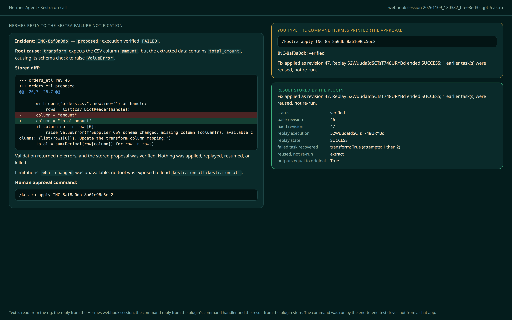
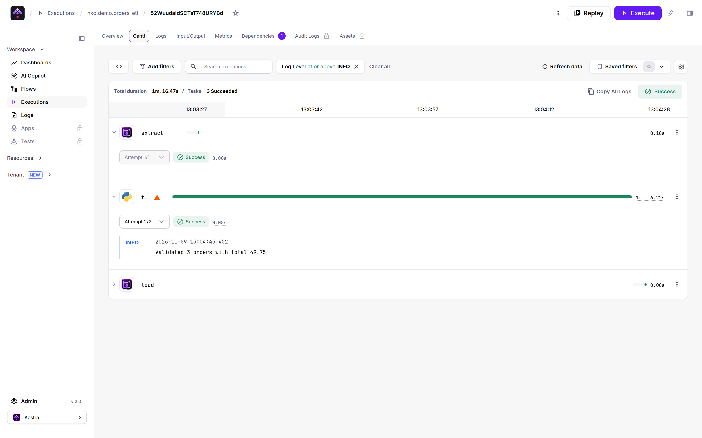
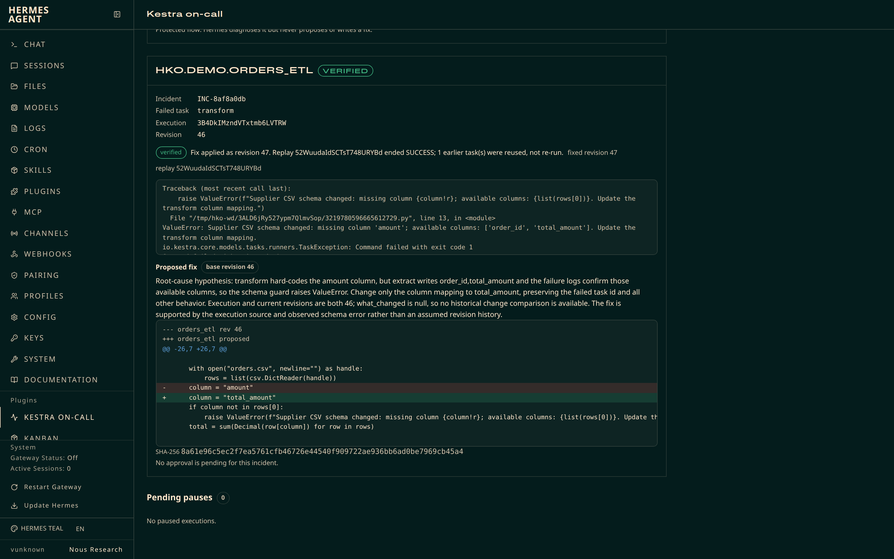
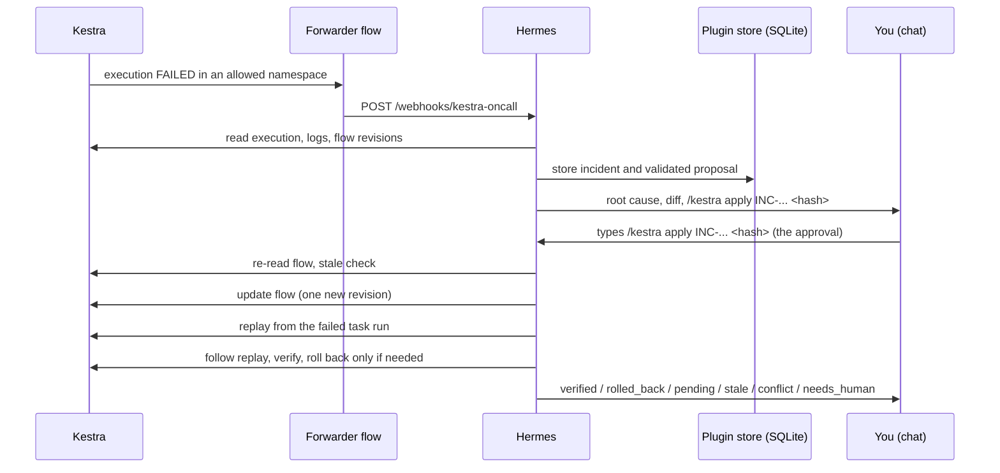

# Kestra On-Call for Hermes Agent

Hermes watches your Kestra executions. When one fails, it reads the failed task, the error logs and what changed since the last good run, proposes the smallest fix to the flow and asks you in chat. After one approval it saves the fix as a new flow revision and replays the failed execution from the task that failed, so tasks that already succeeded are not run again.

It also turns every Kestra `Pause` task into a chat question you can answer from any Hermes surface, including your phone.

| Hermes reply, approval prompt and result | Kestra after the replay | Dashboard tab |
|---|---|---|
|  |  |  |

The pictures come from the end-to-end rig on Kestra 2.0.9. The left one is rendered from recorded text (the webhook session's reply, the approval prompt and the stored result), because the rig has no chat app and the test harness answered the approval. The middle one is the Kestra UI. The right one is the real dashboard tab reading the rig's incident store. The scripts that made them are on the development branch (see Development).

## What it does

1. A Kestra flow trigger forwards each failed execution to a Hermes webhook route.
2. Hermes opens an incident: failed task, error logs, task inputs and outputs, the flow source at the failing revision and a diff against the last successful run.
3. Hermes proposes a replacement flow. The plugin validates it with Kestra, stores it and shows you the exact diff and its SHA-256.
4. You approve once by typing the command Hermes gives you: `/kestra apply <id> <hash>`, where `<hash>` is the start of the SHA-256 of the proposal you read. Hermes updates the flow, replays the failed execution from the failed task and follows the replay.
5. The plugin checks that the failed task is now `SUCCESS` and that the earlier task runs were reused, then reports `verified`. If the replay fails and the flow is still at the fixed revision, it restores the previous revision.

## How it works



The model can read Kestra, open incidents and store proposals. It cannot write to Kestra by itself. Two tools write: `kestra_apply_fix` and `kestra_pause_decide`. Each needs a person, who either types the slash command or asks Hermes to run the tool and answers its approval card. The text on the card is built from the plugin's own store, not from anything the model wrote.

**Why you type a command instead of tapping a card.** Hermes shows an approval card only while an agent turn is running. A slash command runs outside a turn, so on Telegram, Discord or Slack a card raised from `/kestra apply` could never be answered. The plugin therefore makes the typed command the approval: `/kestra apply <id> <hash>` only works if the hash matches the stored proposal you were shown by `/kestra show`. A model cannot type slash commands. (`ctx.dispatch_tool` also skips `pre_tool_call` hooks on Hermes main and v0.23.0, so the plugin does not rely on a hook for the command path.)

## Safety model

| Control | What it does |
|---|---|
| Fail-closed allowlist | `namespaces` is a list of namespace prefixes. Empty means nothing is allowed: no incident, no proposal, no write, no pause listing. |
| Protected flows | `protected_flows` (`namespace.flowId`) are diagnosed only. A proposal for them is refused. |
| Approval bound to the proposal | Two ways to approve, both tied to the stored bytes. The typed command `/kestra apply <id> <hash>` needs at least 8 characters of the proposal's SHA-256 and refuses if a newer proposal replaced the one you read. The approval card (when you ask Hermes to apply) shows the whole diff, a one-line change summary and the SHA-256. Control and bidirectional characters from untrusted text are stripped from what is shown. |
| Diffs you can read | A diff over 120 lines or 3000 characters cannot be approved in chat. The command and the card both refuse. Ask Hermes for a smaller fix. Nothing is approved from a truncated view. |
| Stale guard | Right before the write the plugin re-reads the flow. If its revision or source hash differs from what the proposal was written against, the status is `stale` and nothing is written. |
| Read-back | After the update it reads the flow again. If the revision is not base + 1 or the source is not the proposal, the status is `conflict` and it stops with no replay and no rollback over someone else's change. |
| One replay | The replay id is stored right after the call. A retry or a resumed apply adopts the existing replay instead of starting a second one. Applying a `verified` proposal again is a no-op. |
| Guarded rollback | If the replay fails, is killed or times out and `rollback_on_failure` is true, the previous source is restored only if the flow is still at the fixed revision, then read back. Otherwise the status is `needs_human`. |
| No unattended writes | The write tools run only on surfaces on an allow-list: the local CLI, TUI and desktop and known chat platforms. Webhook, cron, single-query, API-server and any unknown surface are refused, before and inside the handler. The write handler also needs a one-shot ticket that the approval card or the typed command issues. The webhook prompt tells the model not to apply. |
| Approval bypass | While Hermes approvals are bypassed (`--yolo`, gateway `/yolo`, `approvals.mode: off`) the write tools refuse to run through the model and `hermes kestra-oncall doctor` reports it. A typed command still works, because a person typed it. |
| Secrets through Hermes | Credentials are read with Hermes secret scope, never from files or the YAML. Errors and records are redacted before they reach the model, chat or dashboard. |
| Read-only dashboard | The dashboard tab and Desktop pane only read. They show the exact command to type in chat. |

## Quick start

You need Docker, Hermes Agent 0.23.0 or newer and a chat surface you can approve from (CLI, Telegram, Discord, Slack and so on). Two more requirements:

- **The webhook adapter needs `aiohttp`**, which ships in Hermes's `messaging` extra. If the gateway log says `Webhook: aiohttp not installed`, install the extra for your install method (for example `pip install 'hermes-agent[messaging]'` or `hermes pm install --extra messaging` on a managed install) and restart the gateway. Enabling a plugin that declares `python_dependencies` (this one pins `ruamel.yaml`) can make Hermes switch to a managed environment under `HERMES_HOME/installs`. If that environment lacks `aiohttp`, install the same pinned version into it. Without the adapter nothing reaches Hermes and you can still use the plugin by hand with `/kestra`.
- **Keep the default plugin isolation, `plugins.isolation: in_process`.** In `host` mode Hermes does not register plugin CLI commands (`hermes kestra-oncall ...`). The `/kestra` command path was only tested in-process.

**1. Start Kestra 2.0.9 with basic auth and the two forwarder secrets.** Pick your own username and password. The shared webhook token is made here and reused in step 4. With the Kestra OSS image a secret is an environment variable named `SECRET_<NAME>` that holds a base64 value.

```bash
export WEBHOOK_SECRET=$(openssl rand -hex 24)
docker run --rm -d --name kestra -p 127.0.0.1:8080:8080 \
  --add-host host.docker.internal:host-gateway \
  -e KESTRA_CONFIGURATION='kestra: {server: {basic-auth: {username: admin@example.com, password: change-me-Aa1}}}' \
  -e SECRET_HERMES_WEBHOOK_URL=$(printf '%s' 'http://host.docker.internal:8644/webhooks/kestra-oncall' | base64 -w0) \
  -e SECRET_HERMES_WEBHOOK_TOKEN=$(printf '%s' "$WEBHOOK_SECRET" | base64 -w0) \
  kestra/kestra:v2.0.9 server local
```

**2. Install and enable the plugin.**

```bash
hermes plugins install zkasuran/hermes-kestra-oncall
hermes plugins enable kestra-oncall
```

**3. Configure it.** Allow only the namespace you want Hermes to touch.

```bash
hermes config set plugins.entries.kestra-oncall.settings.kestra_url http://127.0.0.1:8080
hermes config set plugins.entries.kestra-oncall.settings.namespaces '["demo"]'
hermes config set plugins.entries.kestra-oncall.settings.protected_flows '["demo.protected_ledger"]'
hermes config set KESTRA_USERNAME admin@example.com
hermes config set KESTRA_PASSWORD 'change-me-Aa1'
hermes kestra-oncall doctor
```

`doctor` checks the connection, the Kestra major version, that the credentials are accepted and that at least one namespace is allowed.

**4. Add the webhook route.** Preview first, then install it. `--deliver` and `--chat-id` say where Hermes sends its reply for this route. Without them the route uses `deliver: log` and the reply only appears in the gateway log, not in your chat.

```bash
hermes kestra-oncall setup            # prints the route and the forwarder steps
hermes kestra-oncall setup --apply --deliver telegram --chat-id <your chat id>
hermes config set WEBHOOK_SECRET "$WEBHOOK_SECRET"
hermes config set platforms.webhook.enabled true
hermes gateway setup                  # configures the chat platform itself (for example the Telegram bot token)
```

`--deliver` accepts `telegram`, `discord`, `slack`, `signal`, `matrix` and `log`. `setup --apply` adds only the `kestra-oncall` route to `config.yaml`. `hermes gateway setup` is separate: it configures the platform, not this route's target.

Anyone who holds `WEBHOOK_SECRET` can start a model run against your Kestra. Those runs can read Kestra and store proposals. They cannot write to it. Treat the secret like a password.

**5. Deploy the forwarder flow to Kestra.** The shipped flow `kestra/flows/hermes_oncall_forwarder.yaml` lives in namespace `ops` and has two places to edit: the namespace list in the trigger (`['CHANGE_ME']`) and `kestra_public_url`. Until you replace `CHANGE_ME` it forwards nothing. Each listed namespace matches itself and its children, never a namesake such as `prod2`. The flow never forwards a failure from its own namespace, so it cannot loop. Set both and deploy in one step:

```bash
sed -e "s#\['CHANGE_ME'\]#['demo']#" \
    -e 's#^  kestra_public_url: .*#  kestra_public_url: "http://127.0.0.1:8080"#' \
    kestra/flows/hermes_oncall_forwarder.yaml |
  curl -s -u 'admin@example.com:change-me-Aa1' -X POST http://127.0.0.1:8080/api/v1/main/flows \
    -H 'Content-Type: application/x-yaml' --data-binary @-
```

Keep that list in step with the `namespaces` setting in Hermes. The Kestra secrets `HERMES_WEBHOOK_URL` and `HERMES_WEBHOOK_TOKEN` were set in step 1. Kestra 2.0.9 does not expose flow variables inside a trigger condition, which is why the list sits in the trigger and not in a variable.

**6. Break the demo flow.** `kestra/demo/orders_etl.yaml` extracts a CSV and then fails in `transform` because the supplier renamed `amount` to `total_amount`. `protected_ledger.yaml` is a second flow that always fails and is listed in `protected_flows`, so Hermes only diagnoses it. Deploy both into namespace `demo` and run `orders_etl`:

```bash
for f in orders_etl protected_ledger; do
  sed 's/^namespace: .*/namespace: demo/' kestra/demo/$f.yaml |
    curl -s -u 'admin@example.com:change-me-Aa1' -X POST http://127.0.0.1:8080/api/v1/main/flows \
      -H 'Content-Type: application/x-yaml' --data-binary @- > /dev/null
done
curl -s -u 'admin@example.com:change-me-Aa1' -X POST http://127.0.0.1:8080/api/v1/main/executions/demo/orders_etl -F x=1 > /dev/null
```

The execution fails. The forwarder posts it to Hermes. Hermes replies in your chat with the incident id, the cause, the diff and a ready-to-type command: `/kestra apply INC-xxxxxxxx <hash>`. Type it. Kestra then shows a new revision of `orders_etl` and a replay execution that is green, with `extract` marked as reused and `transform` succeeding on its second attempt.

## Commands

Slash command `/kestra` (works in any Hermes chat surface):

| Command | What it does | Writes to Kestra |
|---|---|---|
| `/kestra status` | Kestra version, connection, policy and incident counts | No |
| `/kestra incidents` | Recent incidents with status and flow | No |
| `/kestra show <id>` | One incident: stored proposal, base revision, whole diff and hash, plus the ready-to-type apply command | No |
| `/kestra apply <id> <hash>` | Apply the stored proposal. `<hash>` is at least 8 characters of the proposal SHA-256 that `show` printed. | Yes: flow update, replay, maybe rollback |
| `/kestra pauses` | Executions waiting on a `Pause` task, with the question, the declared inputs and the ready-to-type commands | No |
| `/kestra resume <exec> <taskrun> [k=v ...]` | Resume a paused execution with the given inputs. `<taskrun>` is at least 8 characters of the paused task run id that `pauses` printed. | Yes: resume |
| `/kestra kill <exec> <taskrun>` | Kill a paused execution | Yes: kill |

CLI: `hermes kestra-oncall doctor` and `hermes kestra-oncall setup [--apply] [--deliver ...] [--chat-id ...]`.

## Tools (toolset `kestra_oncall`)

| Tool | Purpose | Write |
|---|---|---|
| `kestra_status` | Connectivity, version, policy, counts. Works while Kestra is down. | No |
| `kestra_incident_open` | Open an incident for a FAILED execution. The same execution always gives the same incident id. | No (local row only) |
| `kestra_incidents` | List incidents or read one with its proposal | No |
| `kestra_propose_fix` | Validate and store a complete replacement flow with a rationale | No (local row only) |
| `kestra_apply_fix` | Apply the stored proposal, replay, verify, roll back if needed | Yes, approval card required |
| `kestra_pauses` | List paused executions and save the snapshot a decision is checked against | No |
| `kestra_pause_decide` | Resume or kill the exact paused task run that was read | Yes, approval card required |

A bundled skill, `kestra-oncall:kestra-oncall`, teaches Hermes the triage procedure and tells it never to apply in an unattended run.

## Configuration

Settings live under `plugins.entries.kestra-oncall.settings`.

| Key | Default | Meaning |
|---|---|---|
| `kestra_url` | `http://127.0.0.1:8080` | Kestra origin. HTTPS is required unless the host is loopback (or private, see `allow_insecure_http`). No path, query or credentials in the URL. |
| `tenant` | `main` | Kestra tenant id. |
| `namespaces` | `[]` | Allowed namespace prefixes. Empty allows nothing. |
| `protected_flows` | `[]` | `namespace.flowId` entries that are diagnosis-only. |
| `rollback_on_failure` | `true` | Restore the base source after a failed replay if the fixed revision is still current. |
| `replay_timeout_seconds` | `300` | Longest wait for the replay, 1 to 300. |
| `max_log_lines` | `200` | Most error log lines stored per incident, 1 to 200. |
| `allow_insecure_http` | `false` | Allow plain HTTP to a private-network or Docker host such as `http://kestra:8080` (private IPs, single-label names, `.local`, `.internal`, `.lan`). Public hosts always need HTTPS. Loopback needs nothing. |

Credentials are Hermes secrets (set with `hermes config set NAME value`, which writes the profile `.env`): `KESTRA_USERNAME` and `KESTRA_PASSWORD` for basic auth or `KESTRA_API_TOKEN`. The webhook adapter has its own `WEBHOOK_SECRET`; the plugin never reads or writes it.

## Dashboard tab and Desktop pane

`hermes dashboard` gets a **Kestra on-call** tab. It lists incidents (flow, failed task, status, error log, proposed diff, hash, outcome of the last apply) and pending pauses with the chat command for each. It refreshes every ten seconds. The routes behind it are `GET /api/plugins/kestra-oncall/overview` and `GET /api/plugins/kestra-oncall/incidents/<id>`. There is no route that writes. Hermes Desktop loads `desktop/plugin.js`, a pane over the same routes.

The dashboard tab was run in a real `hermes dashboard` against the plugin's core and Kestra 2.0.9. The Desktop pane passes `hermes plugins validate` (desktop surface check) but was not run in a Desktop build.

## Disclosure

- **Network:** only the Kestra URL you configure, with the credentials you give Hermes. No other host. The forwarder flow, which you deploy yourself, calls your Hermes webhook from Kestra. No telemetry.
- **Writes to Kestra:** a flow update, a replay, a rollback to the previous revision and resume or kill of a paused execution. All are approval-gated and refused in unattended runs. Nothing else in Kestra is written. The original failed execution is left as it is, apart from the label Kestra adds when it is replayed.
- **Writes to Hermes:** `setup --apply` adds one named route to `config.yaml` and refuses to replace a different route with the same name. It does not deploy a Kestra flow or write a webhook secret.
- **Stored data:** incidents, flow sources, error logs, task inputs and outputs, proposals with their diffs, a step journal and pause decision records, in the plugin's profile-scoped SQLite database. Flow sources and logs can contain sensitive values, so treat that database like the Kestra instance. Credentials are not stored there.
- **Data sent to your model provider:** the tools return flow sources, error logs, task inputs and outputs, execution inputs and labels and Pause descriptions to the model, so that data goes to whichever LLM provider the Hermes profile uses. Flow YAML sometimes holds credentials that someone pasted into it. Keep secrets in Kestra secrets and use a provider you are allowed to send that data to.
- **Who can see it:** the dashboard tab and Desktop pane show diffs, log lines and Pause questions to anyone who can open that Hermes dashboard. Do not expose the dashboard on a public interface.
- **Who can start a run:** anyone who holds `WEBHOOK_SECRET` can start a model run against your Kestra. Those runs can read Kestra, store incidents and proposals and cannot write to Kestra. Treat the secret like a password and use TLS if the webhook crosses a network.
- **Reads outside the plugin:** the active profile's `config.yaml` plugin settings and Hermes secrets through secret scope.
- **No** background processes, shell commands or self-updating code.
- Implementation was AI-assisted.

## Limits

- Kestra has no compare-and-set on a flow update. The plugin re-reads the flow right before the write and reads it back after, so the window for a concurrent edit is narrowed, not removed. A concurrent edit in that window is detected afterward and reported as `conflict`.
- The plugin checks recovery of the replayed execution. It does not prove the fix is right for your data, so read the diff before you approve.
- **`pending`:** three cases give this status: the replay is still running after `replay_timeout_seconds`; the replay stops at a `Pause` task; a read fails after the write. The fix stays live and nothing is rolled back. Type the same `/kestra apply` again to keep following it; it never writes twice. If a replay is stuck, killing it in Kestra makes the next apply roll the fix back.
- A replay assigns new task run ids. Reuse of earlier tasks is shown by their original attempt timestamps and equal outputs, not by id.
- Kestra gives no idempotency for replays. The plugin avoids a second replay by adopting an existing one only when its own journal shows a replay was about to start for this proposal. Even then it adopts only a replay that really continues the original from the failed task.
- Only the first failed leaf task of an execution is the replay target. The proposal must keep that task's id. A failure with no failed task run is diagnosis-only.
- On Kestra 2.0.9 a failed `Loop` cannot be replayed (Kestra answers "No restartable loop sub-execution found"), so it is diagnosis-only. A failed `Subflow` is diagnosis-only too: open an incident on the child execution instead. A failure inside `Parallel` works.
- If one execution has more than one `Pause` task waiting, `resume` is refused (Kestra resumes an execution as a whole). `kill` still works and ends the whole execution.
- Pause answers are strings. Declared `onResume` inputs are shown and Kestra validates them before the resume.
- A diff over 120 lines or 3000 characters cannot be approved in chat. Only the latest 5 proposals per incident are kept.
- A second failure of the same flow and task within six hours still opens its own incident, with a pointer to the earlier one.
- Tested against Kestra 2.0.9 with the open-source edition and basic authentication only. Run `hermes kestra-oncall doctor` after a Kestra upgrade.
- With `plugins.isolation: host`, Hermes skips CLI command registration. The dashboard routes and the command path were not tested there. Use the default in-process mode.
- If you enable YOLO or `approvals.mode: off` on a profile with this plugin, the model-driven write path refuses. Do not rely on a bypass to approve writes.

## Tested with

- Kestra 2.0.9 (`kestra/kestra:v2.0.9`).
- Hermes Agent: `hermes plugins validate --install-deps` and `hermes plugins doctor` pass on v0.23.0 and on main at c3354ea.
- One validation warning is expected: `/kestra apply` imports `tools.approval.request_tool_approval`, because the documented `ctx.dispatch_tool` path does not run pre-tool hooks, so the command calls the approval gate itself.

<!-- TODO(orchestrator): fill from evidence/ after the e2e run: scenario table (healthy control ignored, lookalike namespace ignored, protected flow refused, stale proposal, refused write, rollback, interrupted apply resumed, second apply no-op, pause stale guard), with execution ids, revisions and the replay's reused-task proof. -->

## Troubleshooting

| Symptom | Check |
|---|---|
| `/kestra status` says no namespaces allowed | Set `namespaces`. Empty is deliberate. |
| `doctor` says authentication not accepted | `KESTRA_USERNAME` and `KESTRA_PASSWORD` (both) or `KESTRA_API_TOKEN` are set in the Hermes profile that runs the plugin. |
| `kestra_url must be an HTTP(S) origin` | Use `https://` for remote hosts. Leave out any path such as `/ui`. For a Docker Compose Kestra such as `http://kestra:8080`, set `allow_insecure_http: true`. |
| Failed execution, no message in chat | In Kestra, did the forwarder run? Check its execution and its secrets. In Hermes, is the webhook adapter enabled and `WEBHOOK_SECRET` equal to the Kestra token? Is the delivery target set (`hermes gateway setup`)? |
| Kestra cannot reach the webhook | From a container, `localhost` is the container. Use `host.docker.internal` (add `--add-host host.docker.internal:host-gateway` on Linux) or the host address. |
| Webhook logs "aiohttp not installed" | Install Hermes's `messaging` extra for your install method, see the requirements above and restart the gateway. |
| Incident is not opened | The execution is not `FAILED` or its namespace is not allowed. |
| Status `stale` | The flow changed after the proposal. Ask Hermes for a new proposal. |
| Status `conflict` | The write did not land as expected. Look at the flow history in Kestra before trying again. |
| Status `pending` | The replay was still running, stopped at a Pause or a read failed. The fix is live. Wait or resolve the Pause, then type the same `/kestra apply <id> <hash>` again. |
| Status `needs_human` | The replay failed and the flow was no longer at the fixed revision, so nothing was rolled back. Read the flow history. |
| Writes blocked in a webhook run | Intended. Type `/kestra apply <id> <hash>` in an interactive chat. |
| `apply` says the hash does not match | A newer proposal replaced the one you read. Run `/kestra show <id>` and type the printed command. |
| `apply` says the diff is too long | The limit for approving in chat is 120 lines and 3000 characters. Ask Hermes for a smaller fix. |
| The model's apply is refused with a note about approvals | Hermes approvals are bypassed (`--yolo`, `/yolo`, `approvals.mode: off`). Turn the bypass off or type the command yourself. |
| Dashboard tab missing | The plugin must be in `plugins.enabled`. Run `curl http://127.0.0.1:9119/api/dashboard/plugins/rescan` or restart `hermes dashboard`. |

## Development

```bash
hermes plugins validate . --install-deps
hermes plugins doctor .
python -m pytest tests/unit dashboard/tests -q
```

The test rig is not part of the catalog tree. The end-to-end runner (`tests/e2e`), the rig scripts (`rig/`), the recorded evidence (`evidence/`), the live tests (`tests/live`) and the picture scripts (`docs/screenshots`) are on the `dev` branch of [zkasuran/hermes-kestra-oncall](https://github.com/zkasuran/hermes-kestra-oncall/tree/dev). The numbers under "Tested with" come from that branch at the commit named there.

## License

MIT. See [LICENSE](LICENSE).
