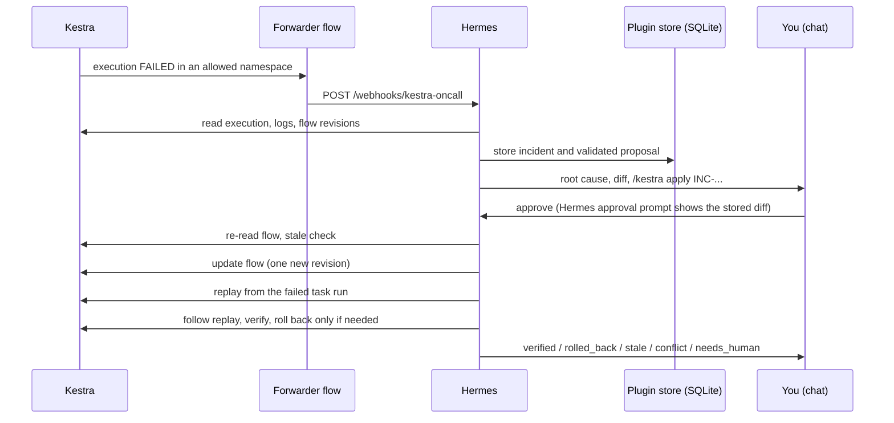

# Kestra On-Call for Hermes Agent

Hermes watches your Kestra executions. When one fails, it reads the failed task, the error logs and what changed since the last good run, proposes the smallest fix to the flow and asks you in chat. After one approval it saves the fix as a new flow revision and replays the failed execution from the task that failed, so tasks that already succeeded are not run again.

It also turns every Kestra `Pause` task into a chat question you can answer from any Hermes surface, including your phone.

<!-- TODO(orchestrator): replace with the captured walkthrough (GIF or three stills). Files: assets/01-chat-diagnosis.png, assets/02-kestra-replay.png. -->
| Hermes chat on the phone | Kestra after the replay | Dashboard tab |
|---|---|---|
|  |  |  |

## What it does

1. A Kestra flow trigger forwards each failed execution to a Hermes webhook route.
2. Hermes opens an incident: failed task, error logs, task inputs and outputs, the flow source at the failing revision, and a diff against the last successful run.
3. Hermes proposes a replacement flow. The plugin validates it with Kestra, stores it, and shows you the exact diff and its SHA-256.
4. You approve once in chat (`/kestra apply <id>`). Hermes updates the flow, replays the failed execution from the failed task and follows the replay.
5. The plugin checks that the failed task is now `SUCCESS` and that the earlier task runs were reused, then reports `verified`. If the replay fails and the flow is still at the fixed revision, it restores the previous revision.

## How it works



The model never writes to Kestra. Two tools can: `kestra_apply_fix` and `kestra_pause_decide`. Both go through the Hermes approval prompt, and the prompt text is built from the plugin's own store, not from anything the model wrote.

## Safety model

| Control | What it does |
|---|---|
| Fail-closed allowlist | `namespaces` is a list of namespace prefixes. Empty means nothing is allowed: no incident, no proposal, no write, no pause listing. |
| Protected flows | `protected_flows` (`namespace.flowId`) are diagnosed only. A proposal for them is refused. |
| Approval bound to the proposal | The approval prompt shows the stored base revision, diff and SHA-256. `kestra_apply_fix` only accepts the hash of the stored proposal, and the approval cache key includes the incident and base revision. |
| Stale guard | Right before the write the plugin re-reads the flow. If its revision or source hash differs from what the proposal was written against, the status is `stale` and nothing is written. |
| Read-back | After the update it reads the flow again. If the revision is not base + 1 or the source is not the proposal, the status is `conflict` and it stops with no replay and no rollback over someone else's change. |
| One replay | The replay id is stored right after the call. A retry or a resumed apply adopts the existing replay instead of starting a second one. Applying a `verified` proposal again is a no-op. |
| Guarded rollback | If the replay fails, is killed or times out, and `rollback_on_failure` is true, the previous source is restored only if the flow is still at the fixed revision, then read back. Otherwise the status is `needs_human`. |
| No unattended writes | In webhook, cron and single-query runs both write tools are blocked by the plugin, before and inside the handler, even if Hermes is configured to auto-approve. The webhook prompt also tells the model not to apply. |
| Secrets through Hermes | Credentials are read with Hermes secret scope, never from files or the YAML. Errors and records are redacted before they reach the model, chat or dashboard. |
| Read-only dashboard | The dashboard tab and Desktop pane only read. They show the command to run in chat. |

## Quick start (about five minutes)

You need Docker, Hermes Agent 0.23.0 or newer, and a chat surface you can approve from (CLI, Telegram, Discord, Slack and so on).

**1. Start Kestra 2.0.9 with basic auth and the two forwarder secrets.** Pick your own username and password. The shared webhook token is made here and reused in step 4. With the Kestra OSS image a secret is an environment variable named `SECRET_<NAME>` that holds a base64 value.

```bash
export WEBHOOK_SECRET=$(openssl rand -hex 24)
docker run --rm -d --name kestra -p 127.0.0.1:8080:8080 \
  --add-host host.docker.internal:host-gateway \
  -e KESTRA_CONFIGURATION='kestra: {server: {basic-auth: {username: admin@example.com, password: change-me-Aa1}}}' \
  -e SECRET_HERMES_WEBHOOK_URL=$(printf '%s' 'http://host.docker.internal:8644/webhooks/kestra-oncall' | base64 -w0) \
  -e SECRET_HERMES_WEBHOOK_TOKEN=$(printf '%s' "$WEBHOOK_SECRET" | base64 -w0) \
  kestra/kestra:v2.0.9 server local
```

**2. Install and enable the plugin.**

```bash
hermes plugins install zkasuran/hermes-kestra-oncall
hermes plugins enable kestra-oncall
```

**3. Configure it.** Allow only the namespace you want Hermes to touch.

```bash
hermes config set plugins.entries.kestra-oncall.settings.kestra_url http://127.0.0.1:8080
hermes config set plugins.entries.kestra-oncall.settings.namespaces '["demo"]'
hermes config set plugins.entries.kestra-oncall.settings.protected_flows '["demo.protected_ledger"]'
hermes config set KESTRA_USERNAME admin@example.com
hermes config set KESTRA_PASSWORD 'change-me-Aa1'
hermes kestra-oncall doctor
```

`doctor` checks the connection, the Kestra major version, that the credentials are accepted and that at least one namespace is allowed.

**4. Add the webhook route.** Preview first, then install it.

```bash
hermes kestra-oncall setup            # prints the route and the forwarder steps
hermes kestra-oncall setup --apply    # adds only the kestra-oncall route to config.yaml
hermes config set WEBHOOK_SECRET "$WEBHOOK_SECRET"
hermes config set platforms.webhook.enabled true
hermes gateway setup                  # choose where replies go, for example your Telegram chat
```

Add `--deliver telegram --chat-id <id>` (or `discord`, `slack`, `signal`, `matrix`) to `setup` to send the reply to a chat.

**5. Deploy the forwarder flow to Kestra.** Edit `kestra/flows/hermes_oncall_forwarder.yaml`: remove `disabled: true`, set `when` to your allowed namespaces (the forwarder must live in a namespace Hermes does not watch) and set `kestra_url`. Deploy it:

```bash
curl -u 'admin@example.com:change-me-Aa1' -X POST http://127.0.0.1:8080/api/v1/main/flows \
  -H 'Content-Type: application/x-yaml' --data-binary @kestra/flows/hermes_oncall_forwarder.yaml
```

**6. Break the demo flow.** `kestra/demo/orders_etl.yaml` extracts a CSV and then fails in `transform` because the supplier renamed `amount` to `total_amount`. Use namespace `demo` (edit the `namespace:` line), deploy it the same way and run it from the Kestra UI. In a minute you get a message with the cause, the diff and `/kestra apply INC-xxxxxxxx`. Reply with that command, approve the prompt, and watch the replay finish green in Kestra with `extract` not run again.

<!-- TODO(orchestrator): confirm steps 1 to 6 once against a clean Hermes home, then record the measured times here. -->

## Commands

Slash command `/kestra` (works in any Hermes chat surface):

| Command | What it does | Writes to Kestra |
|---|---|---|
| `/kestra status` | Kestra version, connection, policy and incident counts | No |
| `/kestra incidents` | Recent incidents with status and flow | No |
| `/kestra show <id>` | One incident: stored proposal, base revision, diff and hash | No |
| `/kestra apply <id>` | Apply the stored proposal after the approval prompt | Yes: flow update, replay, maybe rollback |
| `/kestra pauses` | Executions waiting on a `Pause` task, with the question and inputs | No |
| `/kestra resume <exec> [k=v ...]` | Resume a paused execution with the given inputs after the approval prompt | Yes: resume |
| `/kestra kill <exec>` | Kill a paused execution after the approval prompt | Yes: kill |

CLI: `hermes kestra-oncall doctor` and `hermes kestra-oncall setup [--apply] [--deliver ...] [--chat-id ...]`.

## Tools (toolset `kestra_oncall`)

| Tool | Purpose | Write |
|---|---|---|
| `kestra_status` | Connectivity, version, policy, counts. Works while Kestra is down. | No |
| `kestra_incident_open` | Open an incident for a FAILED execution. The same execution always gives the same incident id. | No (local row only) |
| `kestra_incidents` | List incidents, or read one with its proposal | No |
| `kestra_propose_fix` | Validate and store a complete replacement flow with a rationale | No (local row only) |
| `kestra_apply_fix` | Apply the stored proposal, replay, verify, roll back if needed | Yes, approval required |
| `kestra_pauses` | List paused executions and save the snapshot a decision is checked against | No |
| `kestra_pause_decide` | Resume or kill the exact paused task run that was read | Yes, approval required |

A bundled skill, `kestra-oncall:kestra-oncall`, teaches Hermes the triage procedure and tells it never to apply in an unattended run.

## Configuration

Settings live under `plugins.entries.kestra-oncall.settings`.

| Key | Default | Meaning |
|---|---|---|
| `kestra_url` | `http://127.0.0.1:8080` | Kestra origin. HTTPS is required unless the host is loopback. No path, query or credentials in the URL. |
| `tenant` | `main` | Kestra tenant id. |
| `namespaces` | `[]` | Allowed namespace prefixes. Empty allows nothing. |
| `protected_flows` | `[]` | `namespace.flowId` entries that are diagnosis-only. |
| `rollback_on_failure` | `true` | Restore the base source after a failed replay if the fixed revision is still current. |
| `replay_timeout_seconds` | `300` | Longest wait for the replay, 1 to 300. |
| `max_log_lines` | `200` | Most error log lines stored per incident, 1 to 200. |

Credentials are Hermes secrets (set with `hermes config set NAME value`, which writes the profile `.env`): `KESTRA_USERNAME` and `KESTRA_PASSWORD` for basic auth, or `KESTRA_API_TOKEN`. The webhook adapter has its own `WEBHOOK_SECRET`; the plugin never reads or writes it.

## Dashboard tab and Desktop pane

`hermes dashboard` gets a **Kestra on-call** tab. It lists incidents (flow, failed task, status, error log, proposed diff, hash, outcome of the last apply) and pending pauses with the chat command for each. It refreshes every ten seconds. The routes behind it are `GET /api/plugins/kestra-oncall/overview` and `GET /api/plugins/kestra-oncall/incidents/<id>`. There is no route that writes. Hermes Desktop loads `desktop/plugin.js`, a pane over the same routes.

The dashboard tab was run in a real `hermes dashboard` against the plugin's core and Kestra 2.0.9. The Desktop pane passes `hermes plugins validate` (desktop surface check) but was not run in a Desktop build.

## Disclosure

- **Network:** only the Kestra URL you configure, with the credentials you give Hermes. No other host. The forwarder flow, which you deploy yourself, calls your Hermes webhook from Kestra. No telemetry.
- **Writes to Kestra:** a flow update, a replay, a rollback to the previous revision, and resume or kill of a paused execution. All are approval-gated and refused in unattended runs. Nothing else in Kestra is written. The original failed execution is left as it is, apart from the label Kestra adds when it is replayed.
- **Writes to Hermes:** `setup --apply` adds one named route to `config.yaml` and refuses to replace a different route with the same name. It does not deploy a Kestra flow or write a webhook secret.
- **Stored data:** incidents, flow sources, error logs, task inputs and outputs, proposals with their diffs, a step journal and pause decision records, in the plugin's profile-scoped SQLite database. Flow sources and logs can contain sensitive values, so treat that database like the Kestra instance. Credentials are not stored there.
- **Reads outside the plugin:** the active profile's `config.yaml` plugin settings, and Hermes secrets through secret scope.
- **No** background processes, shell commands or self-updating code.
- Implementation was AI-assisted.

## Limits

- Kestra has no compare-and-set on a flow update. The plugin re-reads the flow right before the write and reads it back after, so the window for a concurrent edit is narrowed, not removed. A concurrent edit in that window is detected afterward and reported as `conflict`.
- The plugin checks recovery of the replayed execution. It does not prove the fix is right for your data, so read the diff before you approve.
- A replay assigns new task run ids. Reuse of earlier tasks is shown by their original attempt timestamps and equal outputs, not by id.
- Kestra gives no idempotency for replays. The plugin avoids a second replay by adopting an existing one for the same original execution and fixed revision.
- Only the first failed leaf task of an execution is the replay target. The proposal must keep that task's id.
- Pause answers are strings. Declared `onResume` inputs are shown, and Kestra validates them before the resume.
- Tested against Kestra 2.0.9 only. Run `hermes kestra-oncall doctor` after a Kestra upgrade.
- With `plugins.isolation: host`, Hermes skips CLI command registration. Use the default in-process mode.

## Tested with

- Kestra 2.0.9 (`kestra/kestra:v2.0.9`).
- Hermes Agent: `hermes plugins validate --install-deps` and `hermes plugins doctor` pass on v0.23.0 and on main at c3354ea.
- One validation warning is expected: `/kestra apply` imports `tools.approval.request_tool_approval`, because the documented `ctx.dispatch_tool` path does not run pre-tool hooks, so the command calls the approval gate itself.

<!-- TODO(orchestrator): fill from evidence/ after the e2e run: scenario table (healthy control ignored, lookalike namespace ignored, protected flow refused, stale proposal, refused write, rollback, interrupted apply resumed, second apply no-op, pause stale guard), with execution ids, revisions and the replay's reused-task proof. -->

## Troubleshooting

| Symptom | Check |
|---|---|
| `/kestra status` says no namespaces allowed | Set `namespaces`. Empty is deliberate. |
| `doctor` says authentication not accepted | `KESTRA_USERNAME` and `KESTRA_PASSWORD` (both) or `KESTRA_API_TOKEN` are set in the Hermes profile that runs the plugin. |
| `kestra_url must be an HTTP(S) origin` | Use `https://` for remote hosts, and no path such as `/ui`. |
| Failed execution, no message in chat | In Kestra, did the forwarder run? Check its execution and its secrets. In Hermes, is the webhook adapter enabled and `WEBHOOK_SECRET` equal to the Kestra token? Is the delivery target set (`hermes gateway setup`)? |
| Kestra cannot reach the webhook | From a container, `localhost` is the container. Use `host.docker.internal` (add `--add-host host.docker.internal:host-gateway` on Linux) or the host address. |
| Webhook logs "aiohttp not installed" | Install the Hermes messaging extra for your install method. |
| Incident is not opened | The execution is not `FAILED`, or its namespace is not allowed. |
| Status `stale` | The flow changed after the proposal. Ask Hermes for a new proposal. |
| Status `conflict` | The write did not land as expected. Look at the flow history in Kestra before trying again. |
| Status `needs_human` | The replay failed and the flow was no longer at the fixed revision, so nothing was rolled back. Read the flow history. |
| Writes blocked in a webhook run | Intended. Approve from an interactive chat with `/kestra apply <id>`. |
| Dashboard tab missing | The plugin must be in `plugins.enabled`. Run `curl http://127.0.0.1:9119/api/dashboard/plugins/rescan` or restart `hermes dashboard`. |

## Development

```bash
hermes plugins validate . --install-deps
hermes plugins doctor .
python -m pytest tests/unit dashboard/tests -q
```

## License

MIT. See [LICENSE](LICENSE).
